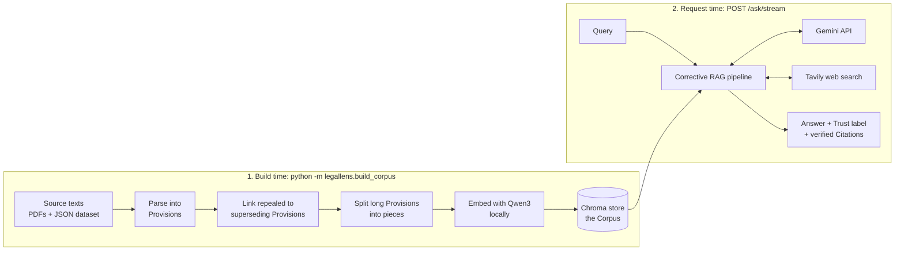
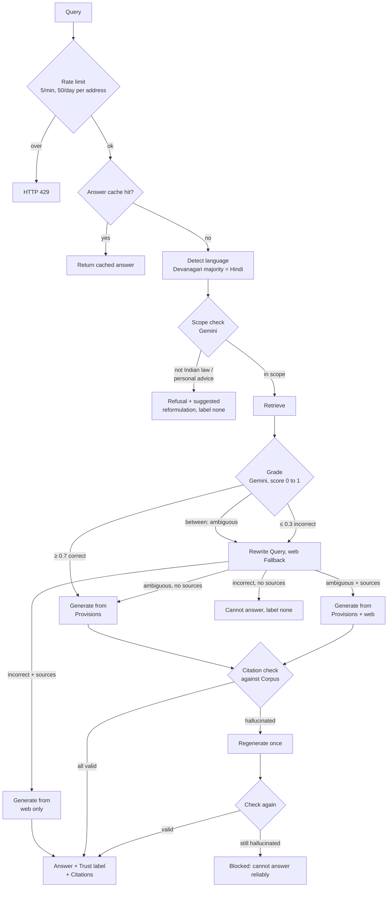
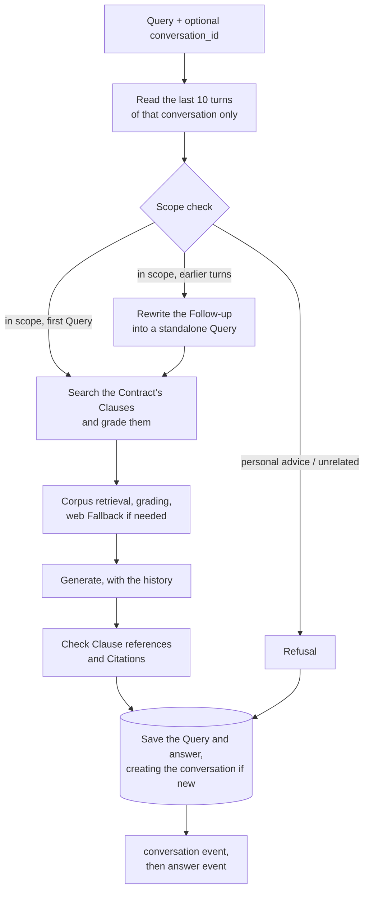

# LegalLens: data and data flow

What data LegalLens uses, where it comes from, and what happens to it from the source documents all the way to an answer on screen. Terms in **bold** (Provision, Chunk, Corpus, Verdict, Stage, Trust label, Citation) are defined in `GLOSSARY.md`.

There are two separate flows:

1. **Build time (offline):** official legal texts become a searchable Corpus.
2. **Request time (online):** a user's Query is answered from that Corpus, and sometimes from the web.

Sections 1 to 5 describe `/ask`. Queries about a user's own **Contract** are stored, unlike `/ask` ones: see section 6.

---

## 1. Data used

### 1.1 The Corpus: 3,693 Provisions across 15 Acts

| Act | Status | Provisions | Source |
|---|---|---|---|
| Constitution of India | in force | 499 (3,693 minus the 3,194 below) | Open dataset `civictech-India/constitution-of-india`, pinned to a commit and a SHA-256 hash, then corrected by `sources/constitution_patches.json` |
| Bharatiya Nyaya Sanhita (BNS) | in force | 358 | Gazette of India Extraordinary 250883 |
| Bharatiya Nagarik Suraksha Sanhita (BNSS) | in force | 531 | Gazette of India Extraordinary 250884 |
| Bharatiya Sakshya Adhiniyam (BSA) | in force | 170 | Gazette of India Extraordinary 250882 |
| Indian Penal Code (IPC) | **repealed** | 575 | Indian Kanoon print (unofficial), plus fixes from `sources/ipc_patches.json` |
| Code of Criminal Procedure (CrPC) | **repealed** | 535 | India Code consolidated text |
| Indian Evidence Act (IEA) | **repealed** | 185 | India Code consolidated text |
| Indian Contract Act, 1872 | in force | 192 | Legislative Department print via Drishti Judiciary (third-party mirror) |
| Consumer Protection Act, 2019 | in force | 107 | Gazette print via PRS India |
| Code on Wages, 2019 | in force | 69 | egazette.gov.in |
| Industrial Relations Code, 2020 | in force | 104 | Gazette print via PRS India |
| Code on Social Security, 2020 | in force | 164 | Gazette print via PRS India |
| Occupational Safety, Health and Working Conditions Code, 2020 | in force | 143 | Gazette print via PRS India |
| Transfer of Property Act, 1882 (Chapter V, leases, only) | in force | 14 | International Insolvency Institute print (unofficial) |
| Model Tenancy Act, 2021 | **model** (a template, not law by itself) | 47 | LiveLaw copy of the Ministry of Housing text (unofficial) |

Where the files live:

- The Constitution JSON is downloaded automatically and cached in `backend/data/raw/`.
- The PDFs cannot be fetched automatically (India Code returns 504s and the Gazette needs a manual download). They sit in `backend/data/raw/criminal/` and `backend/data/raw/everyday/`, which are gitignored. Each is pinned by SHA-256 in `ingestion/sources.py`, and the build fails if a file is missing or its hash differs.
- The commented source registries are `backend/sources/*.json`. They record what each text was checked against and why each patch exists.

### 1.2 Supporting data

| Data | Where | Used for |
|---|---|---|
| Corresponding-section tables (BNS to IPC, BNSS to CrPC, BSA to IEA) | NCRB "Sankalan" PDFs, `backend/data/raw/criminal/` | Linking each repealed Provision to the in-force one that replaced it (`superseded_by` / `supersedes`) |
| Patches | `sources/constitution_patches.json`, `sources/ipc_patches.json` | Corrections to source text, each with a reason and the document it was checked against |
| Sample Corpus | `backend/fixtures/sample_provisions.json` | A 3-Provision stand-in so the app starts with no built Corpus (local only; `REQUIRE_CORPUS=1` forbids it) |
| Golden set | `backend/evaluation/golden_set.json` | 36 test Queries with expected Provisions and reference points, for the evaluation |
| Embedding model | `Qwen/Qwen3-Embedding-0.6B`, downloaded from Hugging Face (~1.1 GB) | Turning text into vectors, locally |

### 1.3 Data about a request

| Data | Lifetime |
|---|---|
| The **Query** (up to 2,000 characters) | Held in memory while the request runs. Sent to Gemini and Tavily (as a rewritten search query). **Never logged and never stored on disk.** |
| The answer | Kept in the in-memory answer cache (up to 500 entries, 24 hours) and cleared on restart. A "cannot answer" is never cached. |
| Rate-limit counters | In memory, per client address (5 per minute, 50 per day). |
| Request log line | One JSON line per request: endpoint, outcome, language, **Query length** (not text), per-Stage timings, Grader score, Verdict, Trust label, error Stage. Written to stderr. |

The frontend stores no user data. It calls the backend and renders the result.

### 1.4 Secrets and external services

| Service | Receives | Setting |
|---|---|---|
| Google Gemini | Query, retrieved Provision text, web snippets | `GOOGLE_API_KEY` |
| Tavily (web search) | An LLM-rewritten English search query, only on the Fallback path | `WEB_SEARCH_API_KEY` |
| Hugging Face | Nothing user-specific; the model is downloaded from it | none |

Everything else (embedding, vector search, citation checking, caching, rate limiting) runs inside the backend process.

---

## 2. Build-time flow: source documents to Corpus

Run with `cd backend && python -m legallens.build_corpus` (`backend/src/legallens/build_corpus.py`).

1. **Fetch and verify.** The Constitution dataset is downloaded (hash-checked). The criminal-law and everyday-law PDFs are read from `data/raw/` and each is hash-checked.
2. **Extract text.** `ingestion/pdf_text.py` turns each PDF into section records of the form `{section, chapter, text}`. There is one adapter per source layout: Gazette prints (BNS, BNSS, BSA and the five everyday Acts), CrPC and IEA from India Code, the IPC from Indian Kanoon, the Transfer of Property Act's lease chapter, and the Model Tenancy Act. The adapters strip page furniture, side-headings, footnotes and amendment marks.
3. **Patch.** `ingestion/record_patches.py` and the Constitution patch file apply recorded corrections. A patch that no longer matches is an error, not a silent skip.
4. **Parse into Provisions.** `ingestion/criminal_codes.py` and `ingestion/everyday_acts.py` turn records into `Provision` objects (Act, chapter, number, Status, text). **One Section or Article is one Provision** (ADR 0002). Duplicate numbers are an error. The Constitution's Preamble is not ingested.
5. **Assign Status.** The old codes are `repealed`, the new codes and Labour Codes are `in_force`, the Model Tenancy Act is `model`.
6. **Link old to new.** The NCRB tables are parsed (`ingestion/mapping_tables.py`). Each repealed Provision gets `superseded_by` (for example IPC 302 to BNS 103) and each in-force one gets `supersedes`. A mapping that names a Provision that does not exist is an error.
7. **Report and gate.** `ingestion/report.py` checks the Provision count per Act against exact expected counts and flags empty or suspicious Chunks. Any warning stops the build and the existing store is left untouched.
8. **Split long Provisions.** A Provision over 800 characters is split at line ends into pieces, because the embedding model reads only about 512 tokens (ADR 0002 amendment).
9. **Embed.** Each piece is embedded locally by Qwen3-Embedding-0.6B. Provisions are embedded as-is. Queries later get the model's built-in `query` instruction prefix.
10. **Store.** Pieces go into a Chroma collection (`provisions`, cosine distance) at `CHROMA_PATH` (default `backend/data/chroma`). The first piece of each Provision carries the whole verbatim text, so a Provision can be fetched whole by `(Act, number)`. The build happens in a `.building` directory and replaces the live store only if clean.

The built store is gitignored. To deploy, `scripts/deploy_space.py` copies it into the backend image together with the code.

---

## 3. Request-time flow: Query to answer

Entry point: `POST /ask/stream` (Server-Sent Events) or `POST /ask` (plain JSON). The browser calls the Next.js frontend, which calls the FastAPI backend. Both routes call one `Answerer` (`backend/src/legallens/answering.py`), which owns the answer cache, the Stage labels, cancellation and the request log line, and runs the corrective loop in `backend/src/legallens/pipeline.py`. It returns an `Answered`: the `AskResponse` plus the `Decisions` the loop made (Grader score and Verdict, Fallback source count, whether a Citation forced a rewrite or blocked the answer).

### Step by step

| # | Stage (id) | What happens | Data in, data out |
|---|---|---|---|
| 0 | Rate limit, cache | Over-limit clients get HTTP 429 before any work. The Query is normalised (whitespace and case ignored) and looked up in the in-memory cache. A hit returns the stored answer with no Gemini calls. | Client address, Query to cached answer or continue |
| 1 | Language | Hindi if most letters are Devanagari, otherwise English. The answer is written in that language. | Query to `en` / `hi` |
| 2 | `scope_check` | Gemini classifies the Query as `in_scope`, `not_indian_law` or `personal_advice`. Out-of-scope Queries stop here with a polite reason and a suggested reformulation. | Query to `ScopeDecision` |
| 3 | `retrieval` | Three things combine: (a) Provisions the Query names outright ("IPC 302", "BNS 103") are fetched directly; (b) the Query is embedded and the 10 nearest Provisions are found, each scored by its best piece; (c) any repealed Provision found brings its superseding Provision along, and matches that have a superseding Provision rank behind those that do not. | Query to up to ~10+ whole Provisions (Chunks) |
| 4 | `grading` | Gemini scores 0.0 to 1.0 how well those Provisions answer the Query. The score becomes a **Verdict**: ≥ 0.7 correct, ≤ 0.3 incorrect, otherwise ambiguous (ADR 0004). | Query + Provisions to score and Verdict |
| 5 | `fallback` (if not correct) | Gemini rewrites the Query as a precise English search query. Tavily searches official domains first (`gov.in`, `nic.in`, `prsindia.org`, `indiankanoon.org`), and the open web only if those return nothing. Up to 5 results, snippets cut to 1,000 characters. Any failure yields no sources. | Rewritten query to title, URL and snippet per source |
| 6 | `generation` | Gemini writes the answer in the Query's language, using only the supplied Provisions and web sources. Web snippets are fenced as untrusted data with angle brackets escaped, so a web page cannot inject instructions. Repealed Provisions are flagged as repealed, and Model Act Provisions as templates. | Provisions + sources + Query to answer text + list of cited (Act, number) pairs |
| 7 | `citation_check` | Every cited (Act, number) is looked up in the Corpus. Valid ones become **Citations** carrying the **verbatim English text from the Corpus**, not Gemini's version. If any is missing (a **Hallucinated citation**), the `citation_recheck` Stage regenerates once. A second failure blocks the answer. | Cited pairs to valid Citations |
| 8 | Finish | For each cited repealed Provision, its superseding Provision is added to the Citations so the user sees the current law. The **Trust label** is set, the response is cached (except a "cannot answer"), and one log line is written. | Final `AskResponse` |

Skipped for answers built from web sources alone: the Citation check does not apply, because there are no Provisions to cite. Those answers carry no Citations and list the web sources instead.

### The Trust label

| Label | Meaning | How it arises |
|---|---|---|
| `corpus` | Supported by statute text only | Verdict correct, or ambiguous with no web sources found |
| `corpus_and_fallback` | Statute text plus web sources | Verdict ambiguous, web sources found |
| `fallback` | Web sources only, no Citations | Verdict incorrect, web sources found |
| `none` | No source supports it | A refusal of an Out-of-scope query, or a "cannot answer" (no web sources, or Citations that could not be verified) |

### What reaches the browser

An `AskResponse` JSON object, streamed as Server-Sent Events: `stage` events as each Stage starts (with a label in the user's language), then one `answer` event (or an `error` event naming the Stage that failed). It contains:

- `response_type` (`answer` or `refusal`), `refusal_reason`, `suggested_reformulation`
- `answer` and `answer_language`
- `trust_label`
- `citations`: Act, chapter, number, Status, verbatim text, `superseded_by`, `supersedes`
- `fallback_sources`: title, URL, snippet

The frontend renders the answer, links provision mentions to the Citations, and shows the Trust label. It also serves a read-only `/law` browser fed by `GET /acts`, `/acts/{act}` and `/provision/{act}/{number}`, which read the Corpus directly with no Gemini calls and no rate limit.

### Plain-RAG baseline (evaluation only)

With `crag=False` the pipeline skips grading and the Fallback: scope check, retrieval, generate, Citation check. The evaluation (`python -m legallens.evaluate`) runs the 36 golden Queries through two `Answerer`s (one per mode, no answer cache, no HTTP in between), has a Gemini judge score each answer against the reference points, and writes `backend/evaluation/report.md`.

---

## 4. Where data is trusted, checked or changed

| Point | Protection |
|---|---|
| Source files | SHA-256 pinned; build fails on mismatch or missing file |
| Parsed text | Exact per-Act Provision counts, duplicate and gap checks, cross-checks against other copies (`backend/scripts/verify_*.py`), recorded patches |
| Old-to-new links | A mapping to a non-existent Provision fails the build |
| Bad build | Never replaces a good store |
| Query in | Length-capped at 2,000 characters, scope-checked, rate-limited |
| Web content in | Fenced as untrusted data and HTML-escaped before it reaches Gemini |
| Gemini output out | Every Citation verified against the Corpus, and Citation text always comes from the Corpus, never from the model |
| Privacy | Query text and answers never written to logs. The log line holds only the Query's length and language |

## 5. Known limits worth knowing

- The IPC, Transfer of Property Act and Model Tenancy Act texts are unofficial prints. The IPC, CrPC and IEA are not yet checked against India Code, and India Code was unreachable for several Acts (see `sources/criminal_codes.json` and `sources/everyday_acts.json`).
- The Gazette-print Acts are as enacted, so they carry no later amendments.
- Only Chapter V (leases) of the Transfer of Property Act is included.
- The Model Tenancy Act is a template; answers citing it say so.
- The answer cache and rate limiter are per process and in memory, so a restart clears them.
- Web Fallback answers rest on less reliable sources. This is why the Trust label is always shown.

---

## 6. Contracts and Contract conversations

### What is stored (Postgres)

| Table | Holds |
|---|---|
| `users` | The Clerk user id |
| `contracts` | Title, extracted text, page count and the **Contract brief** (`brief`, JSON). The uploaded file is never kept |
| `clauses` | Each Clause (long ones in pieces) with its 1024-dimension vector |
| `contract_conversations` | One row per **Contract conversation**: its Contract, `title` (the first Query, shortened to 60 characters), `created_at`, `updated_at` (set on every turn) |
| `contract_messages` | The Queries and answers: `contract_id`, `conversation_id`, `role`, `payload`. A Query and its answer share a `turn` id |
| `usage` | Per-user daily counts for the caps |

Foreign keys cascade: deleting a conversation removes its messages; deleting a Contract removes its Clauses, conversations and messages; Clerk's `user.deleted` webhook removes the user and all of it. Every read and write is filtered by the signed-in user's id through the Contract.

Migration `0005` moved the brief out of `contract_messages` (where it was the first message) into `contracts.brief`, and turned each Contract's saved Queries into its first conversation. A Contract with no Queries got none.

### A Query about a Contract

`POST /contracts/{id}/ask/stream`, through `ContractAnswerer` (`backend/src/legallens/contract_answering.py`):

- A conversation is created only by its first answered Query, in the same transaction. A failure, or the client leaving, saves nothing.
- A new conversation starts with no history. The Contract brief is never part of any conversation's history.
- A **Follow-up** is first rewritten by Gemini, from the Query and the history, into a standalone Query in the Query's language (Stage `follow_up`). That rewrite drives the Clause search (a named "Clause 7" included), the Clause Grader, Corpus retrieval and the Corpus Grader. What is saved, shown and given to generation is the user's own wording, with the history. If the rewrite fails, the Query is searched as asked.
- A conversation's first Query is not rewritten.
- The web Fallback never sees the rewrite: its search is made from the user's own Queries in the conversation (the current one and the last 10 before it).

### Privacy

Contract text goes to the model and the database only. It is never logged, and the web Fallback's search is built from the user's own Queries, never from Clause text, answers or the Follow-up rewrite (ADR 0006). There is no answer cache for Contract answers.

