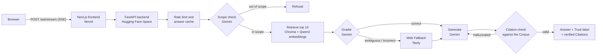

# LegalLens

Indian-law assistant using Corrective RAG. See `GLOSSARY.md` and `docs/adr/`.

Demo: not deployed yet. [Deploy](#deploy) explains how, and this line gets the link once it is live.

LegalLens is for information only and is not legal advice.

## Architecture



The Citation check regenerates once when an answer cites a Provision that is not in the Corpus,
then blocks the answer. Answers reach the browser only after that check. See `docs/adr/` for why.

## Backend setup

Requires **Python 3.14** (recorded in `backend/pyproject.toml`). All dependencies, including torch,
chromadb and sentence-transformers, install from prebuilt wheels on 3.14.

```bash
cd backend
python3 -m venv .venv
source .venv/bin/activate
pip install -e ".[dev]"
pytest
```

The first embedding run downloads `Qwen/Qwen3-Embedding-0.6B` (about 1.1 GB) from Hugging Face.
A Corpus built with another embedding model must be rebuilt (`python -m legallens.build_corpus`); vectors from different models do not mix.
The torch wheel alone is ~140 MB, so the first install can be slow on a slow connection.

## Build the Corpus

```bash
cd backend && python -m legallens.build_corpus
```

Downloads the Constitution dataset pinned in `ingestion/sources.py` (hash-checked), applies the
corrections recorded in `backend/sources/constitution_patches.json`, prints Chunk counts per Act
and exits non-zero if a count or Chunk looks wrong. The vector store is rebuilt from scratch at
`CHROMA_PATH` (default `backend/data/chroma`).

To re-verify the text against the official Constitution of India PDF (Ministry of Law and Justice,
as on May 2022, hosted on the India Code CDN):

```bash
cd backend && python scripts/verify_constitution.py path/to/official.pdf
```

## Run locally

Secrets come from environment variables only. Copy `backend/.env.example` to `backend/.env`
and set `GOOGLE_API_KEY` and `WEB_SEARCH_API_KEY` (a Tavily key for the web Fallback). The other settings are optional; the table below lists them.

```bash
# backend (http://localhost:8000); uses the built Corpus; seeds a small fixture Corpus on first question if none is built
cd backend && .venv/bin/uvicorn legallens.main:app --env-file .env

# frontend (http://localhost:3000); set NEXT_PUBLIC_API_URL if the backend is elsewhere
cd frontend && npm install && npm run dev
```

### Settings

All are environment variables for the backend (`backend/.env.example` has them with their defaults).

| Variable | Default | What it does |
|---|---|---|
| `GOOGLE_API_KEY`, `WEB_SEARCH_API_KEY` | none | Gemini, and Tavily for the web Fallback. Secrets. |
| `GEMINI_MODEL` | `gemini-3.5-flash-lite` | The Gemini model. Free-tier quotas are per model. |
| `GEMINI_FALLBACK_MODEL` | none | A second model tried once when the first still fails after 3 retries (503, spent quota). |
| `CORS_ORIGINS` | `http://localhost:3000` | Comma-separated frontend addresses allowed to call the backend. |
| `CHROMA_PATH` | `backend/data/chroma` | Where the built Corpus is. |
| `RATE_LIMIT_PER_MINUTE`, `RATE_LIMIT_PER_DAY` | 5 and 50 | Per client address, on `/ask` and `/ask/stream`; over the limit gets HTTP 429 with `Retry-After`. Set both to 0 to turn it off, for example for local work. |
| `ANSWER_CACHE_SIZE`, `ANSWER_CACHE_TTL_SECONDS` | 500 and 86400 | Answers to repeated Queries are remembered in memory. Size 0 turns it off. A "cannot answer" is never remembered. |
| `REQUIRE_CORPUS` | off | Set to `1` to fail, instead of seeding the 3-Provision sample Corpus, when the store is empty. |
| `WARM_START` | off | Set to `1` to load the Corpus and embedding model at startup instead of on the first question. |

`GET /health` says the process is up. `GET /ready` says the Corpus loads, how many Provisions it has,
and whether it is only the sample (`"fixture": true`). Use `/ready` as a deployment health probe.

### Logs

Each question writes one JSON line to the server's log (a Space's Logs tab shows it), for seeing where
time and Gemini quota go:

```json
{"event": "request", "endpoint": "ask_stream", "outcome": "answer", "language": "en", "query_chars": 38,
 "cache_hit": false, "total_ms": 6120, "stages_ms": {"scope_check": 900, "retrieval": 410, "grading": 1100,
 "generation": 3300, "citation_check": 2}, "grader_score": 0.82, "verdict": "correct",
 "response_type": "answer", "trust_label": "corpus"}
```

It also records the Fallback's source count, `citation_recheck` and `citation_blocked` when they happen, and
`error_stage` when a request fails. The Grader's score and Verdict are there to tune the 0.7 and 0.3
thresholds against real questions. A line never holds the Query or the answer, only the Query's length and
language, because Queries can describe people's personal situations.

## Deploy

The frontend goes on Vercel and the backend on a Hugging Face Docker Space (free CPU tier, 16 GB RAM).
Secrets live in the hosts' settings and are never committed or baked into the image.

```bash
./scripts/deploy-wizard.sh
```

The wizard walks through the steps only you can do (Hugging Face token and Space, API keys, the Vercel
project, the allowed frontend address), runs the upload for you after asking, and finishes by checking the
live `/ready` and CORS. It stores its values in `.deploy.env`, which is gitignored, and can be re-run.

What it does, if you would rather do it by hand:

1. **Build the Corpus** locally (`python -m legallens.build_corpus`). It is gitignored, so it cannot be built from a clone.
2. **Upload the backend.** `python backend/scripts/deploy_space.py STAGE_DIR --push USER/SPACE` puts
   `backend/Dockerfile`, the code and the built Corpus in `STAGE_DIR` and uploads them to the Space. Without
   `--push` it only assembles the files. It refuses to ship an empty Corpus or the sample.
   The image installs the versions pinned in `backend/constraints.txt`, because a Chroma store is only
   guaranteed to load under the version that wrote it. It downloads the embedding model while building.
3. **Set the Space's secrets and variables:** `GOOGLE_API_KEY`, `WEB_SEARCH_API_KEY` (secrets) and
   `CORS_ORIGINS` set to the Vercel address (a variable).
4. **Deploy the frontend** on Vercel with root directory `frontend` and `NEXT_PUBLIC_API_URL` set to the
   Space's address. It is read at build time, so changing it needs a redeploy.

The Space sleeps when idle, so the first question after a quiet spell is slow. The container starts uvicorn
with `--proxy-headers`, so the rate limit sees each visitor's real address; the streaming endpoint sends
`X-Accel-Buffering: no` so proxies do not hold back Stage updates.

To run the image locally (needs a built Corpus at `backend/data/chroma` and Docker running):

```bash
docker build -t legallens-api backend
docker run --rm -p 7860:7860 --env-file backend/.env legallens-api   # then: curl localhost:7860/ready
```

## Evaluation

Compares plain RAG (retrieve and generate, no Grader, no Fallback) with CRAG on a golden set of
36 Queries in `backend/evaluation/golden_set.json`: English (15, across every Act in the Corpus),
Hindi (5), repealed-code (6), out-of-scope (5) and poor-retrieval (5, topics the Corpus does not
cover). Every case goes through the real `/ask` endpoint against the built Corpus.

```bash
cd backend && python -m legallens.evaluate   # needs GOOGLE_API_KEY, WEB_SEARCH_API_KEY and a built Corpus
```

It writes `backend/evaluation/report.md`. Requests are throttled to 15 per minute (`--per-minute`)
for the Gemini free tier, so a full run takes about 20 minutes and uses roughly 300 requests.

- **Retrieval hit-rate**: the response cites at least one of the case's expected Provisions (cases with expected Provisions only).
- **Answer accuracy**: a Gemini judge compares the answer with the case's reference points. Out-of-scope cases are correct only when refused, and Hindi cases only when answered in Hindi.
- **Citation validity (after blocking)**: no Citation in the response fails the Hallucinated-citation check against the Corpus. This is 100% by construction, because the endpoint blocks Hallucinated citations.
- **Hallucinated citations before blocking**: the share of generated answers whose first generation cited a Provision missing from the Corpus. It counts only generations that had Provisions to cite, so CRAG answers from web sources alone are not in it.

The report shows case counts per mode, because a mode that hit Gemini errors on different cases is scored on different cases.

### Results

Latest run (2026-11-18, `gemini-3.1-flash-lite`, Tavily Fallback searching official domains first, full Corpus of 3,501 Chunks embedded with `Qwen/Qwen3-Embedding-0.6B`, retrieval top 10).
This is the same model as the previous run (2026-11-17), so it is the like-for-like comparison with the Fallback change.
All 72 case runs completed: both modes are scored on all 36 cases. Two Gemini errors (one 429, one 503) were recovered by the retry, so nothing is excluded.
The 2026-11-17 run scored CRAG on 33 cases (three failed on Gemini 503s), so the case sets differ slightly. With so few cases per category, one case moves a figure by 7 to 25 points.

| Metric | Plain RAG | CRAG |
|---|---|---|
| Retrieval hit-rate | 96% | 92% |
| Answer accuracy | 86% | 94% |
| Citation validity (after blocking) | 100% | 100% |
| Hallucinated citations before blocking | 0% | 0% |

| Category (answer accuracy) | Cases (plain / CRAG) | Plain RAG | CRAG |
|---|---|---|---|
| English | 15 / 15 | 100% | 93% |
| Hindi | 5 / 5 | 100% | 100% |
| Repealed-code | 6 / 6 | 100% | 100% |
| Out-of-scope | 5 / 5 | 100% | 100% |
| Poor-retrieval | 5 / 5 | 0% | 80% |

Does CRAG beat plain RAG?

- **Ahead:** poor-retrieval Queries (0% to 80%, 4 of 5), where the Fallback to web sources answers what the Corpus cannot. This is the only clear difference.
- **Behind on English (100% to 93%, one case):** `en-ir-strike`. Its Grader sent it to the web Fallback (a Corpus hit for plain RAG) and the web answer was scored wrong. In the previous run the same case went to the Fallback and was correct. This is the one place the official-sources-first change may have hurt, but it is a single case and the judge's reason is not in the report, so it is not established.
- **Effect of the Fallback change on poor-retrieval:** 80%, as before, but the wrong case moved: `poor-rti` is now correct (it was the one wrong case) and `poor-drunk-driving` is now wrong (it was correct in the previous run on this model; its Verdict is now `corpus_and_fallback`, so ambiguous, rather than Fallback alone). One case each way, so no net change, but both flips are on the Fallback path.
- **Expectation not fully met:** the other categories were expected to stay at 100% and English CRAG is 93%, because of `en-ir-strike`. Hindi, repealed-code and out-of-scope stayed at 100%.
- Overall CRAG accuracy is 94% (34 of 36), against 97% (32 of 33) before. The two wrong cases are `en-ir-strike` and `poor-drunk-driving`, both on the Fallback path; the earlier run's `en-wages-overtime` and `rep-ipc-302` and `en-mta-deposit` were excluded then and are correct now.
- Retrieval hit-rate CRAG 92% against 96%: the same `en-ir-strike` (the Grader sent it to the Fallback, so the answer cited no expected Provision).

Also run on `gemini-3.5-flash-lite` the same day (commit `8e2e665` has its report): plain RAG 92% hit-rate and 81% accuracy, CRAG 92% and 92%; poor-retrieval CRAG 80%; English and Hindi CRAG 93% and 80%, on `en-wages-overtime` and `hi-mta-deposit`. Model choice moves single cases both ways, so differences of one case between the two models are noise at this size.

Other notes:

- Retrieval with Qwen3-Embedding-0.6B puts the expected Provision in the top 10 for 23 of the 26 retrieval cases (20 with `multilingual-e5-small`; ADR 0003). The report's hit-rate counts what the response cites, so it can differ from this retrieval count.
- Hallucinated-citation rate before blocking is 0% in both modes: nothing was blocked in this run. CRAG answers that rely on web sources alone are not in this rate.

Per-case detail is in `backend/evaluation/report.md`.
