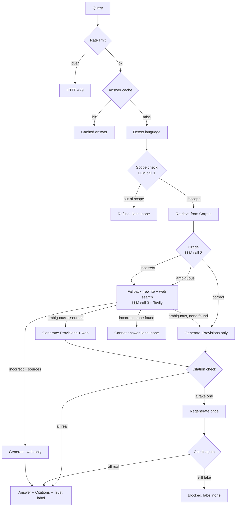

# The Corrective RAG pipeline, start to end

This document explains exactly what happens between a user typing a question and an answer appearing on screen. It follows the code in `backend/src/legallens/`, mainly `pipeline.py` (the decision logic), `main.py` (the HTTP layer), `corpus.py` (retrieval), `llm.py` (every Gemini call), `fallback.py` (web search) and `citation_check.py` (verification).

Terms in **bold** (Query, Provision, Chunk, Corpus, Verdict, Stage, Fallback, Trust label, Citation) are defined in `GLOSSARY.md`. The design decisions behind the pipeline are in `docs/adr/0001` to `0004`. For the offline side (how the Corpus is built) see `INGESTION.md` and `DATA_FLOW.md`.

---

## 1. The idea in one page

**Plain RAG** retrieves some text, hands it to an LLM, and trusts whatever comes back. Its weak point is that retrieval can return the wrong text, and the LLM will then write a confident answer from it anyway.

**Corrective RAG (CRAG)** adds a judge between retrieval and generation. After retrieving, the pipeline asks: *do these Provisions actually answer the question?* The judgement (the **Verdict**) decides what happens next:

| Verdict | Meaning | What the pipeline does |
|---|---|---|
| `correct` | The Corpus answers it | Answer from the Provisions alone |
| `ambiguous` | Partly relevant | Answer from the Provisions **plus** a web search |
| `incorrect` | The Corpus does not answer it | Throw the Provisions away and answer from the web search alone |

LegalLens layers three more safeguards on top, because legal answers carry real consequences:

1. A **scope check** before any retrieval, so personal advice and non-Indian-law questions are refused.
2. A **Citation check** after generation: every Provision the model cites must exist in the Corpus, and the cited text shown to the user is copied from the Corpus, never from the model.
3. A **Trust label** on every answer saying whether it rests on statute text, web sources, both, or nothing.



A single request makes between **1 and 5 Gemini calls**: scope check (always), grading (CRAG mode), query rewrite (only on the Fallback path), generation (once, or twice if a Citation fails the check). Embedding the Query is local and costs no API call.

---

## 2. Two ways in, one pipeline

The frontend (Next.js) calls the FastAPI backend. There are two endpoints, both defined in `main.py`, and both end up calling the same function, `answer_query()` in `pipeline.py`.

| Endpoint | Returns | Used by |
|---|---|---|
| `POST /ask/stream` | Server-Sent Events: a `stage` event as each Stage starts, then one `answer` event (or an `error` event) | The web app, so the user sees progress |
| `POST /ask` | One JSON `AskResponse` when everything is done | Simple clients, and the evaluation harness |

The request body is `{"query": "..."}`. `AskRequest` (`models.py`) trims whitespace, rejects a blank Query, and rejects anything over **2,000 characters**, all before the pipeline runs.

### 2.1 Gate 1: the rate limiter

`rate_limit.py`. Before any work starts, a FastAPI dependency (`limit`) calls `RateLimiter.check(client_ip)`. Each client address has two sliding windows: **5 requests per 60 seconds** and **50 per 24 hours** (`RATE_LIMIT_PER_MINUTE`, `RATE_LIMIT_PER_DAY`). Over either limit, the request is rejected with **HTTP 429** and a `Retry-After` header. Because this happens in a dependency, a streamed response never starts for a rejected request. Rejected requests are not recorded, so retrying early does not extend the wait. State is in memory per process.

Its purpose is to protect the Gemini free tier on a public demo.

### 2.2 Gate 2: the answer cache

`answer_cache.py`. The Query is normalised (whitespace collapsed, case-folded), and the cache is keyed on `(normalised query, crag flag)`. On a hit, the stored `AskResponse` is returned immediately with **zero Gemini calls**. For `/ask/stream` a hit emits just the one `answer` event with no Stages.

- In-memory LRU: up to **500 entries**, **24 hour** TTL (`ANSWER_CACHE_SIZE`, `ANSWER_CACHE_TTL_SECONDS`).
- A "cannot answer" (`answer` response with Trust label `none`) is **never cached**, since it may have come from a temporary outage of the web search or of Citation checking. A *refusal* of an out-of-scope Query is cached, since that outcome is settled.
- A restart clears it, which is also how a rebuilt Corpus takes effect.

### 2.3 How streaming works

`/ask/stream` runs `answer_query()` on a background thread. The pipeline reports progress through an `on_stage(stage_id)` callback. The callback pushes a `stage` event (with the label in the user's language, from `STAGE_LABELS`) onto a queue, and the HTTP response drains the queue as SSE frames. Details:

- A `: keepalive` comment frame is sent every 10 seconds of silence so proxies do not time the connection out.
- If the client disconnects, a flag is set, and the *next* call to `on_stage` raises `_ClientGone`, which stops the pipeline at its next Stage boundary. This saves Gemini quota.
- Any exception in the pipeline becomes an `error` event naming the Stage that was running, and a generic "service unavailable" message. The exception text is logged server-side, never sent to the browser.

---

## 3. The pipeline, Stage by Stage

`answer_query(query, corpus, llm, fallback, crag=True, on_stage, trace)` in `pipeline.py`. The `on_stage` callback is how Stages are reported; `trace` is a dictionary the pipeline fills in with its decisions for the request log.

### Stage 0: Language detection (local, instant)

`language.py`. The answer language is decided from the Query's letters: if **more than half are Devanagari** (Unicode U+0900 to U+097F) the language is Hindi (`hi`), otherwise English (`en`). A Query with no letters defaults to English. Only English and Hindi are supported.

The result is used for: the generation prompt ("Write the answer in Hindi"), the Stage labels, and the fixed messages (refusal text, "cannot answer" text). It is **not** used for retrieval, which is multilingual by itself (see Stage 2).

### Stage 1: `scope_check` (LLM call 1)

`GeminiLLM.classify()`. Gemini is asked to classify the Query into one of:

| Category | Meaning |
|---|---|
| `in_scope` | Anything about Indian law, including general "what does the law say" questions |
| `not_indian_law` | Other countries' law, or no legal topic at all |
| `personal_advice` | Asks LegalLens to choose for the user: whether to take a step (sue, sign, plead, settle, quit) or which of several to take |

"What can I do?" and "What should I do now?" are **in scope**, in either language, even when the user describes their own situation: they are answered with the law and the remedies, without choosing among them. So is asking whether the law allows a step ("Can I sue?"), as opposed to whether to take it. The prompt names the language to write the reason and suggestion in, from `language.py`, so an English Query is not offered a Hindi one.

The output is forced into a typed `ScopeDecision` (Pydantic, via Gemini structured output): `category`, `reason`, `suggested_reformulation`.

If the category is anything but `in_scope`, the pipeline **stops here**. It returns an `AskResponse` with `response_type="refusal"`, the reason (written in the Query's language), a suggested Query the assistant *could* answer, written to be asked as it stands (for personal advice this is typically "what does the law say about this situation, and what can be done?"), and Trust label `none`. If Gemini left the reason empty, a built-in default is used; if it suggested nothing, none is offered. On `/ask`, pressing "Ask this instead" sends the suggestion. No retrieval, no grading, no web search happens, which is why this check is first: refused questions cost one call.

### Stage 2: `retrieval` (local, no API call)

`_retrieve()` in `pipeline.py`, using `Corpus.search()` and `Corpus.get()` in `corpus.py`. Retrieval combines three things. All of it runs locally.

**(a) Explicitly named Provisions.** `refs.find_references()` scans the Query with regular expressions for things like `IPC 302`, `section 302 of the IPC`, `BNS 103`, `धारा 302 IPC`. A table of aliases maps each spelling (`ipc`, `i.p.c.`, `indian penal code`, ...) to the exact Act name. Each match is fetched **directly by key**, `Corpus.get(act, number)`. This matters because embeddings are poor at matching a bare section number (the embedding evaluation found that cases depending on naming a section, such as IPC 302 or IEA 65B, are missed by every model tried).

**(b) Semantic search.** `Corpus.search(query, k=10)`:

1. The Query is embedded locally with **Qwen3-Embedding-0.6B** (`embeddings.py`), with the model's built-in `query` instruction prefix, producing a normalised vector. Because the model is multilingual, a Hindi Query lands near the English Provision text without translation.
2. Chroma is asked for the nearest `k × 5 = 50` stored **pieces** by cosine distance. (Long Provisions are stored as several pieces of about 800 characters, because the model reads about 512 tokens. See ADR 0002.)
3. Pieces are collapsed to their Provision, keeping the order of each Provision's *best* piece, and the top 10 distinct Provisions are kept.
4. Each is re-fetched whole from piece 0, which stores the full verbatim text. So **the pipeline only ever sees whole Provisions, never fragments.**

Provisions already found in (a) are removed from the semantic results so there are no duplicates.

**(c) Old-to-new ordering and expansion.** The Corpus holds both repealed codes (IPC, CrPC, Evidence Act) and the in-force ones that replaced them (BNS, BNSS, BSA) from 1 July 2024. Each repealed Provision carries a `superseded_by` link (e.g. IPC 302 to BNS 103). So:

- Semantic matches that **have** a superseding Provision are sorted *behind* those that do not (a stable sort, so similarity order is otherwise kept). Current law ranks ahead of repealed law.
- For every repealed Provision in the result, its superseding Provision is **appended** if not already present.

The final list is `named + semantic + superseding`. It is therefore usually about 10 whole Provisions, and can be more when explicit references or superseding links add to it. An empty Corpus search yields an empty list.

### Stage 3: `grading` (LLM call 2) and the Verdict

*Skipped in plain-RAG mode (`crag=False`).*

`GeminiLLM.grade()` shows Gemini the retrieved Provisions (each formatted as `[Act: ... | Section: ...] (status) text`) and the Query, and asks for a single relevance score from 0.0 to 1.0:

- 1.0: they directly answer it
- 0.5: partly relevant or incomplete
- 0.0: irrelevant

The score is clamped to [0, 1]. If there are **no** Provisions at all, the score is 0.0 without calling Gemini. `verdict_for()` then maps the score to a **Verdict** with fixed thresholds (ADR 0004):

```
score >= 0.7   ->  correct
score <= 0.3   ->  incorrect
otherwise      ->  ambiguous
```

The score (rounded to 2 places) and Verdict go into the request log's `trace`. The thresholds are starting values chosen in ADR 0004, to be re-tuned against the golden set.

A notable design choice: the Verdict is made by the LLM on the *whole retrieved set at once*, not per Provision. This is simpler and cheaper than the per-document grading in the original CRAG paper, at the cost of less granular filtering.

### Stage 4: `fallback` (LLM call 3 + web search) — only when the Verdict is not `correct`

`_search_fallback()` in `pipeline.py`, `TavilyFallback` in `fallback.py`.

**Step 1: rewrite.** `GeminiLLM.rewrite()` turns the user's question (which may be in Hindi, or conversational) into a concise **English web-search query using precise legal terms** and naming the relevant statute if clear. The raw Query is never sent to the search provider; only this rewrite is.

**Step 2: search, official sources first.** `TavilyFallback.search()` runs up to two searches against Tavily's API:

1. First restricted to `include_domains = gov.in, nic.in, prsindia.org, indiankanoon.org` (a bare domain also covers its subdomains, and `nic.in` covers India Code).
2. **Only if that returns nothing**, once more on the open web.

Up to **5 results** are returned per search. Each becomes a `FallbackSource(title, url, snippet)` with the snippet clipped to **1,000 characters**. (This amendment to ADR 0004 was made after an open-web search for an RTI fee returned a YouTube video and a Facebook post among the top five.)

**Failure handling.** `_search_fallback` wraps everything in `try/except`. Any failure (no API key, HTTP error, timeout of 10 seconds, bad response) is logged and yields **no sources** rather than failing the request. With no `WEB_SEARCH_API_KEY` configured, `NoFallback` is used and always returns no sources. The number of sources found is recorded in the trace as `fallback_sources`.

### Stage 5: Branching on the Verdict

After the Fallback, the pipeline takes one of five paths:

| Verdict | Web sources found? | Provisions passed on | Trust label | Citation check? |
|---|---|---|---|---|
| `correct` | not searched | all retrieved | `corpus` | yes |
| `ambiguous` | yes | all retrieved **+** web sources | `corpus_and_fallback` | yes |
| `ambiguous` | no | all retrieved | `corpus` | yes |
| `incorrect` | yes | **none** (web sources only) | `fallback` | no (nothing to cite) |
| `incorrect` | no | n/a | `none` | n/a: "cannot answer" |

So the degradation is graceful: an ambiguous Verdict with a failed web search still answers from the Corpus, while an incorrect Verdict with a failed web search honestly says it cannot answer instead of guessing from irrelevant statute text.

The "cannot answer, no sources" message (`CANNOT_ANSWER_NO_SOURCES`, in English and Hindi) says the Corpus does not cover the question and the web search could not supply reliable sources, and asks the user to rephrase.

### Stage 6: `generation` (LLM call 4)

`GeminiLLM.generate()` in `llm.py`. The prompt contains the rules, the Provisions, any web sources, and the Query. The model must return a typed `Generation`: an `answer` string and a list of `citations`, each a `(act, number)` pair (`ProvisionRef`).

Key instructions in the prompt:

- Answer **only** from the Provisions and web sources supplied, in plain language, in the Query's language.
- Provision text is English: refer to Provisions by the exact Act name and number as listed, and do **not** translate Act names.
- Cite only listed Provisions, with Act and number in separate fields, **one Citation per Provision** (never a list). Never cite a web source as a Provision.
- If the material does not answer the question, say so and cite nothing.
- Do not give personal advice. When the Query asks what the user can do, set out each remedy the material supports, with where to go and any time limit, and never say which to choose.
- **Repealed** Provisions (marked in the context): say they are no longer law since 1 July 2024, point to the replacing Provision, and prefer citing the in-force one. When an in-force Provision lists the old one it replaced, mention the old equivalent.
- **Model** Provisions (Model Tenancy Act): say they are a template, not binding law, and the user's State law may differ.
- When there are **no Provisions** (the `incorrect` path), answer from web sources, say plainly the answer rests on less reliable web sources and not statute text, and cite nothing.

**Web content is treated as hostile.** Each source is wrapped in its own `<web_source title=... url=...>` fence. Title, URL and snippet are HTML-escaped (`html.escape`), so a web page cannot close its fence with `</web_source>` and pose as instructions. The prompt tells the model the text is untrusted data and to ignore any instructions inside it. This is a prompt-injection defence for the one place where uncontrolled text enters the model's context.

**Model resilience.** Gemini is called with `temperature=0`, a 30 second timeout and up to 3 retries with backoff for transient errors (429, 503). If `GEMINI_FALLBACK_MODEL` is set, a call that still fails is retried once on the second model (free-tier quotas are per model). The default model is `gemini-3.5-flash-lite` (`GEMINI_MODEL`). Every structured call (classify, grade, rewrite, generate) uses this same wrapper.

### Stage 7: `citation_check` (local) and `citation_recheck`

`_answer()` in `pipeline.py` and `check_citations()` in `citation_check.py`.

*Skipped for the `incorrect` path:* with no Provisions supplied there is nothing to cite, so the answer is returned straight after generation with `citations=[]` and the web sources listed.

Otherwise:

1. For every `(act, number)` in the model's citations (deduplicated), `Corpus.get(act, number)` looks it up by exact key.
2. Found: it becomes a `Citation` built **from the Corpus record**: Act, chapter, number, Status, **verbatim English text**, and the `superseded_by` / `supersedes` links. The user never sees text the model wrote as a quotation of the law.
3. Not found: it is a **Hallucinated citation**.

If any citation is hallucinated, the pipeline emits the `citation_recheck` Stage and **regenerates once** (the same inputs, a second `generate` call), then checks again. If it *still* has a hallucinated citation, the answer is **blocked**: the user gets `CANNOT_ANSWER_RELIABLY` ("could not confirm this answer's citations against the Corpus") with Trust label `none` and no citations. An unverifiable answer is never shown. The trace records `citation_recheck` and `citation_blocked`.

### Stage 8: Finishing

1. **Add current law.** `_with_superseding()`: for each cited repealed Provision, its superseding Provision is added to the Citations if not already there, so the user always sees the text of the *current* law next to the repealed one they asked about. (Cited IPC 302 produces BNS 103 as an extra Citation.)
2. The `AskResponse` is assembled: `answer`, `answer_language`, `trust_label`, `citations`, `fallback_sources`.
3. The answer is stored in the cache (except a "cannot answer").
4. One log line is written (section 5).
5. The result is sent to the browser.

---

## 4. The output

### 4.1 `AskResponse`

```
response_type          "answer" | "refusal"
refusal_reason         set for a refusal
suggested_reformulation  set for a refusal, when there is a Query to suggest
answer                 the text
answer_language        "en" | "hi"
trust_label            "corpus" | "corpus_and_fallback" | "fallback" | "none"
citations[]            act, chapter, number, status, text (verbatim, from the Corpus), superseded_by, supersedes
fallback_sources[]     title, url, snippet
```

### 4.2 The Trust label

| Label | Meaning | Arises from |
|---|---|---|
| `corpus` | Statute text only | Verdict `correct`; or `ambiguous` and no web sources found |
| `corpus_and_fallback` | Statute text and web sources | Verdict `ambiguous`, sources found |
| `fallback` | Web sources only, no Citations | Verdict `incorrect`, sources found |
| `none` | No source supports it | A refusal; a "cannot answer" (no sources); or a blocked answer (unverifiable citations) |

Because web answers rest on less reliable sources (ADR 0001 accepted this for broader recall), the label is always shown to the user.

### 4.3 Where each outcome comes from

| Outcome | `response_type` | Label | Citations | Web sources |
|---|---|---|---|---|
| Out-of-scope refusal | `refusal` | `none` | none | none |
| Corpus answer | `answer` | `corpus` | verified | none |
| Corpus + web answer | `answer` | `corpus_and_fallback` | verified | listed |
| Web-only answer | `answer` | `fallback` | none | listed |
| No sources ("cannot answer") | `answer` | `none` | none | none |
| Unverifiable citations ("cannot answer reliably") | `answer` | `none` | none | none |

---

## 5. Observability

`request_log.py`. Exactly one JSON line per request is written to stderr (picked up by a host's log viewer):

```
event, endpoint, outcome (answer | error | client_gone), language, query_chars,
cache_hit, total_ms, stages_ms{scope_check, retrieval, grading, ...},
grader_score, verdict, fallback_sources, citation_recheck, citation_blocked,
response_type, trust_label, error_stage
```

A Stage's duration is the time until the next Stage starts, and a Stage that runs twice (generation after a rewrite) is summed.

**Privacy rule:** the Query and the answer are never logged, only the Query's *length* and language, because Queries may describe people's personal situations.

---

## 6. Plain-RAG baseline (`crag=False`)

The same code with the corrective loop switched off, used to measure what CRAG adds. After retrieval it goes straight to generation: no grading, no Fallback, no web sources, Trust label always `corpus`, still with the scope check and the Citation check. It is selected with `create_app(crag=False)`, and the cache keys on the flag so the two modes never share answers.

`python -m legallens.evaluate` runs 36 golden Queries (`backend/evaluation/golden_set.json`) through both modes via the real endpoint, has a Gemini judge score each answer against reference points, and writes `backend/evaluation/report.md`. In the latest committed report, overall answer accuracy is 86% for plain RAG and 94% for CRAG; the gain comes almost entirely from the `poor_retrieval` category (0% to 80%), where the Corpus lacks the answer and the Fallback supplies it. Citation validity is 100% in both modes and no hallucinated citations occurred before blocking. Retrieval hit-rate is slightly lower in the CRAG run (92% vs 96%); the report does not explain the gap. These are small samples (for example, 5 poor-retrieval cases), so treat single-case differences as noise.

---

## 7. Failure modes and how each is handled

| What goes wrong | What happens |
|---|---|
| Client over the rate limit | HTTP 429 with `Retry-After`; nothing runs |
| Query blank or over 2,000 characters | HTTP 422 validation error |
| Query is off-topic or asks for personal advice | Refusal with a suggested reformulation, after one Gemini call |
| Corpus lacks the topic | Grader scores low; Fallback supplies web sources (label `fallback`) |
| Web search fails, Verdict ambiguous | Answer from the Corpus only (label `corpus`) |
| Web search fails, Verdict incorrect | "Cannot answer" (label `none`), not cached |
| Model cites a Provision that does not exist | Regenerate once; if it happens again, block the answer |
| A web page contains injected instructions | Fenced, escaped and flagged as untrusted data in the prompt |
| Gemini 429/503 | Retried with backoff, then tried on the second model if configured; otherwise the request errors (HTTP 503, or an SSE `error` event naming the Stage) |
| Client closes the stream | The pipeline stops at its next Stage boundary |
| Corpus store is empty | Local: seeded from a 3-Provision sample. With `REQUIRE_CORPUS=1`, startup fails instead, so a deployment never silently answers from the sample |

## 8. Honest limits of the design

- **The Citation check proves a Provision exists, not that it supports the claim.** It catches invented citations, not a real citation attached to a wrong statement. The verbatim text shown beside the answer lets the user judge that themselves.
- **The recheck is a plain retry.** Generation runs at temperature 0 with identical inputs, so the second attempt may reproduce the first; a regeneration helps mainly when Gemini's output is not fully deterministic.
- **The grade is one number for the whole retrieved set.** A single irrelevant Provision cannot be dropped; only the set as a whole is judged.
- **Verdict thresholds (0.7 and 0.3) are hand-set** and rest on a small golden set.
- **Web-only answers carry no Citations**, so their claims cannot be verified against the Corpus. The Trust label is the only safeguard, plus the listed source links.
- **Citation matching is exact** on the Act name and number as stored, so the prompt tells the model to copy both exactly.
- **Cache and rate limiter are per process and in memory**, so they reset on restart and are not shared across instances.
- Source-text caveats (unofficial prints for some Acts, no later amendments for Gazette-print Acts) are listed in `DATA_FLOW.md`.

## 9. Configuration reference

| Variable | Effect | Default |
|---|---|---|
| `GOOGLE_API_KEY` | Gemini access | required |
| `GEMINI_MODEL` | Primary model | `gemini-3.5-flash-lite` |
| `GEMINI_FALLBACK_MODEL` | Second model tried once when the first fails | unset |
| `WEB_SEARCH_API_KEY` | Tavily key; unset disables the Fallback | unset |
| `RATE_LIMIT_PER_MINUTE` / `RATE_LIMIT_PER_DAY` | Per-address limits; both 0 turns it off | 5 / 50 |
| `ANSWER_CACHE_SIZE` / `ANSWER_CACHE_TTL_SECONDS` | Cache size (0 = off) and lifetime | 500 / 86400 |
| `CHROMA_PATH` | Location of the built Corpus | `backend/data/chroma` |
| `REQUIRE_CORPUS` | `1` refuses to start on an empty Corpus | unset |
| `WARM_START` | `1` loads the Corpus and embedding model at startup | unset |
| `CORS_ORIGINS` | Allowed browser origins | `http://localhost:3000` |

Constants in code: `TOP_K = 10`, `CORRECT_THRESHOLD = 0.7`, `INCORRECT_THRESHOLD = 0.3` (`pipeline.py`); `PIECE_CHARS = 800` (`corpus.py`); `PREFERRED_DOMAINS`, `MAX_SNIPPET_CHARS = 1000` (`fallback.py`).

## 10. Worked examples

**A. "What is the punishment for murder under IPC 302?"** (explicit reference, repealed code)
Scope: in scope. Retrieval: `find_references` fetches IPC 302 directly; semantic search adds nine more; IPC 302's `superseded_by` appends BNS 103. Grader: high score, Verdict `correct`. Generation notes IPC 302 is repealed since 1 July 2024 and points to BNS 103. Citation check passes. Citations: IPC 302 plus BNS 103. Label: `corpus`. No web call.

**B. "Should I sue my landlord?"**
Scope: `personal_advice`. Refusal with the reformulation "What does Indian law say about a landlord's obligations to a tenant?", label `none`. One Gemini call, nothing retrieved.

**C. A question the Corpus does not cover** (for example, an RTI application fee)
Scope: in scope. Retrieval returns loosely related Provisions. Grader: 0.1, Verdict `incorrect`. The Query is rewritten to an English search string; Tavily searches official domains, returns government pages. Generation uses the web sources only and says so plainly. No Citation check. Label: `fallback`, with source links shown.

**D. A Hindi question about wages**
Language: `hi`. The embedder matches the Hindi Query to English Provisions of the Code on Wages. The answer is written in Hindi, the Act names stay in English, and the Citations show the verbatim English Provision text from the Corpus.
